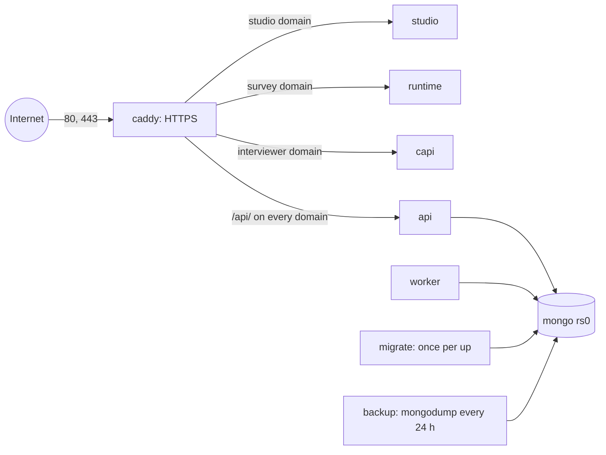

# Testing, deployment and maintenance

This file covers how SampCode is tested, built, released, rolled back, backed up and monitored, and
what to do regularly to keep it healthy. Every section separates **Implemented** (exists in the
repository and was checked) from **Recommended** (not built yet).

The deeper guides it builds on: [ADR 0042 Docker Compose deployment](../adr/0042-docker-compose-deployment.md),
[docs/operations/go-live.md](../operations/go-live.md),
[docs/operations/database.md](../operations/database.md) and
[ADR 0009 local quality gates](../adr/0009-local-quality-gates.md).

## 1. Testing

### Implemented

| Layer                 | Tool                     | Where                                                                                                                                                  | Run it                                                                                               |
| --------------------- | ------------------------ | ------------------------------------------------------------------------------------------------------------------------------------------------------ | ---------------------------------------------------------------------------------------------------- |
| Package unit tests    | Vitest                   | `packages/*/src/**/*.test.ts` (logic-engine 19 files, analysis-core 4, survey-schema 2, quality-core 2, redirect-core 1, quantum 1, survey-renderer 1) | `pnpm test` or `pnpm --filter @zapx/logic-engine test`                                               |
| API integration tests | Vitest + a real database | `apps/api/test/*.test.ts` (one file per milestone or phase, 31 files)                                                                                  | `pnpm --filter @zapx/api test` (needs MongoDB at `DATABASE_URL`)                                     |
| End-to-end (browser)  | Playwright               | `e2e/tests/*.spec.ts` (28 files: `milestone*.spec.ts`, `blueprint*.spec.ts`, `quantum`, `neon`, `eyetracking`, `super-admin`, `security-fixes`)        | `pnpm e2e` (builds must exist; starts API, studio, runtime and CAPI from `e2e/playwright.config.ts`) |
| Mobile app _(PR #40)_ | Vitest, `tsc`            | `apps/mobile/test/*.test.ts` (API client, logic, entitlements; a test checks the feature keys match the server)                                        | `cd apps/mobile && npm ci && npm run typecheck && npm test` (inside `pnpm check`)                    |
| Deployment            | `docker compose`         | `docker-compose.prod.yml`; the `deploy-smoke` workflow boots it over HTTPS and restores a backup                                                       | `docker compose config` inside `pnpm check` when Docker is installed; the workflow in CI             |
| Static checks         | Prettier, ESLint, `tsc`  | `.prettierrc`, `eslint.config.*`, every `tsconfig.json`                                                                                                | `pnpm format:check`, `pnpm lint`, `pnpm typecheck`                                                   |
| Secret scan           | own script               | `scripts/secret-scan.mjs`, also in the pre-commit hook `.githooks/`                                                                                    | `pnpm secrets:scan`                                                                                  |
| Dependency audit      | `pnpm audit`             | accepted exceptions in [docs/security.md](../security.md)                                                                                              | inside full `pnpm check`                                                                             |
| Everything at once    | `scripts/check.sh`       | —                                                                                                                                                      | `pnpm check` / `--quick` / `--no-docker` / `--no-e2e`                                                |

Results at the time of writing: on 2026-11-05 (branch `mobile-app`) `pnpm test` passed **651 tests**
(api 322, logic-engine 133, quantum 108, analysis-core 37, quality-core 21, redirect-core 18,
survey-schema 6, survey-renderer 6). On 2026-11-06, after #44–#46 were merged, the full
`pnpm check --no-docker` passed on `main` (`68f4531`) with Node 26, including all 29 browser tests.

The GitHub workflows `.github/workflows/ci.yml` and `codeql.yml` exist but **do not run**: GitHub
refuses to start the jobs ("recent account payments have failed or your spending limit needs to be
increased"), so every pull request shows red checks that are not code failures (ADR 0009). Fixing the
account's billing under GitHub → Settings → Billing would let them run. Until then `pnpm check` on
your machine is the gate.

### How to test a change

1. `pnpm --filter <package> test` for the package you changed, while working.
2. Add or update a test in the same area: a package `*.test.ts`, an API `apps/api/test/*.test.ts`
   (they start the real Express app with `createApp()` against a real database), or a Playwright spec for a screen flow.
3. Before pushing: `pnpm check --quick` (format, lint, build, typecheck, database indexes, all tests).
4. Before a release: full `pnpm check` (adds audit, the production compose check, e2e and Docker images).

### Recommended (not implemented)

- **Studio component tests.** `apps/studio` has no unit tests; it is covered only by Playwright.
  Vitest + Testing Library for the form-heavy pages (survey editor, vendors, settings) would catch
  regressions faster.
- **Coverage report.** No coverage threshold is configured. `vitest run --coverage` per package
  would show untested areas.
- **Load test** of the respondent path (`/api/public/...`, `apps/api/src/interview/interview.controller.ts`) before a large launch, for example
  with k6, against staging only.
- **Restore test** on a schedule (see section 6).
- **Turn the GitHub workflows on** if the repository moves to a plan with Actions; they already
  mirror `pnpm check`.

## 2. Building

| What                     | Command                                   | Output                                                                                         |
| ------------------------ | ----------------------------------------- | ---------------------------------------------------------------------------------------------- |
| Everything               | `pnpm build`                              | `packages/*/dist`, `apps/api/dist`, `apps/studio/.next`, `apps/runtime/dist`, `apps/capi/dist` |
| One app and its packages | `pnpm --filter @zapx/api... build`        | same, for that app only (`...` includes its dependencies)                                      |
| Docker images            | `docker compose build`                    | images for every service in `docker-compose.yml`                                               |
| One image                | `docker build --target api -t zapx-api .` | targets: `api`, `migrate`, `worker`, `studio`, `runtime`, `capi`                               |

`Dockerfile` facts: base `node:26-bookworm-slim` (nginx `1.31-alpine` for runtime and CAPI); `api`, `migrate`, `worker` and `studio` run as
the unprivileged `node` user; `api` has a health check on `/api/health`; `migrate` runs
`apps/api/dist/cli/migrate.js` and exits; `worker` runs `apps/api/dist/worker.js`; `runtime` and
`capi` are static builds served by `nginx:1.27-alpine` with the headers in `infra/nginx/`.

## 3. Running a full stack locally with Docker

### Implemented

```bash
docker compose up -d --build  # mongo, migrate (once), api, worker, studio, runtime, capi
docker compose ps
curl -s localhost:4000/api/health
```

Ports: studio 3000, API 4000, runtime 5173, CAPI 5174, MongoDB 27017. In this setup the `api`
service has `JOB_WORKER=off` and `CALLBACK_WORKER=off` and the `worker` service does the background
work. `docker-compose.yml` uses example secrets and opens every port: it is for development and
evaluation only. Production is section 4.

## 4. Releasing to production (Docker Compose on one server)

### Implemented

`docker-compose.prod.yml` ([ADR 0042](../adr/0042-docker-compose-deployment.md)) runs everything on one
Linux server from the same images:



- Only Caddy is published (80 and 443); it gets Let's Encrypt certificates for `STUDIO_DOMAIN`,
  `RUNTIME_DOMAIN` and `CAPI_DOMAIN` (`infra/caddy/Caddyfile`).
- MongoDB: one-member replica set with a key file, a root user and an app user (`readWrite` on `zapx`),
  not published on the host.
- Settings: `.env.production` (from `.env.production.example`). The file refuses to load without the
  domains, the three secrets and the MongoDB passwords.
- Checked in CI by the `deploy-smoke` workflow (boots it over HTTPS with Caddy's local certificates,
  takes and restores a backup), and by `docker compose config` in `scripts/check.sh`. **Not yet run on
  a real server with real domains.**

### First-time setup

Follow [docs/operations/go-live.md](../operations/go-live.md#deploying-with-docker-compose): a server
with Docker, DNS for the three domains, `.env.production`, then

```bash
docker compose -f docker-compose.prod.yml --env-file .env.production up -d --build
```

Create the first organization with a temporary `ALLOW_SIGNUP=true` (then back to `false` and `up -d`).

### Each release

```bash
pnpm check                                  # all gates green first (on your machine)
# on the server:
git pull
TAG=$(git rev-parse --short HEAD) docker compose -f docker-compose.prod.yml --env-file .env.production up -d --build
```

Compose rebuilds the images, runs `migrate` (the index sync) and only then replaces the API and worker.
The index sync runs **before** new code starts, so every schema change must work with the code that is
still running (add fields as optional first, remove old ones in a later release; a new unique rule must
hold for the data already stored). The API is down for the few seconds its container restarts.

### Checks after a release

```bash
curl -s https://<studio-domain>/api/health                  # {"ok":true}
docker compose -f docker-compose.prod.yml --env-file .env.production ps                  # every service running, api healthy, migrate exited 0
docker compose -f docker-compose.prod.yml --env-file .env.production logs --since 15m api worker
```

Then sign in to the studio, open one survey, and open one test link in the runtime.

## 4b. Releasing the mobile app _(PR #40)_

The Android and iOS apps are built and signed in the cloud by Expo Application Services (EAS). The full
steps, accounts and costs are in [docs/operations/mobile-release.md](../operations/mobile-release.md).
In short:

| Step                        | Command or place                                                                                                                                            |
| --------------------------- | ----------------------------------------------------------------------------------------------------------------------------------------------------------- |
| One time                    | Expo account, Google Play Console (USD 25 once), Apple Developer Program (USD 99 a year); decide the bundle id `com.sampledge.zapx` before the first upload |
| Link the project            | `cd apps/mobile && npm ci && npx eas-cli@latest login && npx eas-cli@latest init`                                                                           |
| Test build (Android `.apk`) | `npx eas-cli@latest build --profile preview --platform android`                                                                                             |
| Store builds                | `npx eas-cli@latest build --profile production --platform all`                                                                                              |
| Submit                      | `npx eas-cli@latest submit --platform android` / `--platform ios` (Play internal track, TestFlight)                                                         |
| JavaScript-only update      | `npx eas-cli@latest update --channel production` (over the air, no store review)                                                                            |
| Force old apps to update    | set `MOBILE_MIN_VERSION` on the API                                                                                                                         |

The server needs nothing extra: the app uses the studio address and `/api`. `CAPI_APP_URL` must be
reachable from phones. **Not done yet:** no store build or submission has been made; it needs the
owner's store accounts.

## 5. Rolling back

### Implemented

- **Index sync failed:** `migrate` exits non-zero, so compose does not start the new API and worker;
  the old containers keep running. The usual cause is existing data that breaks a new unique rule (see
  [TROUBLESHOOTING.md 5b](TROUBLESHOOTING.md#5b-unique-rule-not-enforced-or-index--already-exists-with-different-options)).
- **Restarts:** every long-running service has `restart: unless-stopped`; Docker restarts a crashed
  container and starts the stack again after a server reboot.

### Manual rollback to an earlier version

```bash
git checkout <previous-good-commit>          # so the runtime and CAPI builds match too
TAG=$(git rev-parse --short HEAD) docker compose -f docker-compose.prod.yml --env-file .env.production up -d --build
```

If the images for that tag are still on the server (`docker image ls 'sampcode-*'`), `up -d` without
`--build` reuses them. **Data changes are not undone.** If a release changed documents in a way the old
code cannot use, restore from backup or fix them with a forward script. Keep schema changes
backward-compatible to avoid this.

### Recommended

- Tag each release (`git tag release-<date>`), so the previous good commit is known without searching.
- Keep the last few images (`docker image prune` only removes untagged ones).

## 6. Backup and restore

### Implemented

| What               | How                                                                                                                                          |
| ------------------ | -------------------------------------------------------------------------------------------------------------------------------------------- |
| Production         | The `backup` service: `infra/scripts/backup.sh` every `BACKUP_INTERVAL_HOURS` (24) into `BACKUP_DIR` (`./backups`), keeps `BACKUP_KEEP` (14) |
| Local / any server | `DATABASE_URL=... infra/scripts/backup.sh [dir]` writes `sampcode-<UTC time>.archive.gz` (mongodump archive)                                 |
| Restore            | [docs/operations/database.md](../operations/database.md#backups-and-recovery), or `infra/scripts/restore.sh <file>` outside Docker           |

Targets written in [docs/operations/database.md](../operations/database.md): RPO 24 hours with the
daily backup, RTO ≤ 1 hour. They are targets, not measured values.

Rules:

- The backups are on the same disk as the database: **copy `./backups` off the server every day**.
- Files (exports, media, CAPI photos) are not in the database backup. In production they are in the
  `files` Docker volume (or S3 with `FILE_STORE=s3`); back that up too (database.md shows how).
- Practise restores on staging, not on the live database.

Restore drill (local):

```bash
DATABASE_URL='mongodb://localhost:27017/zapx_restore_test?directConnection=true' \
  infra/scripts/restore.sh backups/sampcode-<timestamp>.archive.gz
mongosh 'mongodb://localhost:27017/zapx_restore_test?directConnection=true' --eval 'db.Response.countDocuments()'
mongosh 'mongodb://localhost:27017/zapx_restore_test?directConnection=true' --eval 'db.dropDatabase()'
```

### Recommended

- Run the restore drill monthly and write the time it took (that is your measured RTO).
- Automate the off-server copy (a cron job with `rsync`, `rclone` or `aws s3 sync`) and alert when it
  fails.

## 7. Production environment checklist

The API refuses to start in production without these (enforced in `apps/api/src/config.ts`):

- `NODE_ENV=production`, `COOKIE_SECURE=true`
- `JWT_SECRET` (32+ characters, not the example) and its own `SECRETS_KEY` (32+, not `JWT_SECRET`)
- `SIGNING_KEYS_SECRET` (32+, not `JWT_SECRET` or `SECRETS_KEY`)
- `CALLBACK_ALLOW_PRIVATE_HOSTS` and `SSO_ALLOW_INSECURE_ISSUER` false
- `S3_BUCKET` when `FILE_STORE=s3`

With PR #38 the provider keys can instead be entered after the first sign-in under Settings →
Integrations (the operator organization's administrators or the super admin). With PR #41, make the
first super admin right after the first release:
`docker compose -f docker-compose.prod.yml --env-file .env.production exec api node apps/api/dist/cli/set-super-admin.js <email>`.

`docker-compose.prod.yml` sets `NODE_ENV`, `COOKIE_SECURE`, the public URLs (from the domains) and
`TRUST_PROXY_HOPS=1` (Caddy) itself, and defaults `ALLOW_SIGNUP` to false. Behind a CDN, also set
`EDGE_SHARED_SECRET` and `TRUST_PROXY_HOPS=2`. Full list: [CONFIGURATION.md](CONFIGURATION.md).

## 8. Monitoring

### Implemented

- **Health:** `GET /api/health` (database round trip). Used by the Docker `HEALTHCHECK`; the studio,
  runtime and CAPI app wait for it before they start.
- **Logs:** `docker compose -f docker-compose.prod.yml --env-file .env.production logs`, kept by Docker (json-file, at most 5 × 20 MB per container).
- **Alarms:** none are built in for the Docker Compose deployment (see Recommended).
- **Super admin console** _(PR #41)_: activity across every organization (`/super-admin/activity`),
  each member's last request and client (`lastSeenAt`, `lastClient`), and platform automation runs.
- **In the app:** the audit log (Settings → Audit), vendor callback and webhook delivery logs, job
  status per survey, AI usage and budgets.

### Recommended

- An external uptime check on day one (for example UptimeRobot or Better Stack) on
  `https://<studio-domain>/api/health` and the respondent runtime URL, to email or chat.
- Disk space alerts on the server (MongoDB data, backups and Docker images share the disk).
- Alarms for **worker health** (no `JobWorker` log line in 10 minutes, or `Job` rows stuck in
  `QUEUED`) and **dead callbacks** (`OutboundCallback.state = 'DEAD'`).
- Structured JSON logs with a request id, so one request can be followed across API and worker.

## 9. Maintenance recommendations

### Rotating secrets

Each secret has one job (security review S5), so a rotation has a known effect:

| Secret                | Effect of rotating it                                                                                         |
| --------------------- | ------------------------------------------------------------------------------------------------------------- |
| `JWT_SECRET`          | Everyone is signed out (sign in again). Nothing else changes                                                  |
| `SIGNING_KEYS_SECRET` | Test links already shared stop working; duplicate checks no longer match respondents from before the rotation |
| `SECRETS_KEY`         | Stored secrets can no longer be decrypted: re-enter them (vendor partner and SSO client secrets, webhooks)    |

After a leak of `JWT_SECRET` alone, rotate only `JWT_SECRET`. Before PR "security hardening"
(`SIGNING_KEYS_SECRET` unset) `JWT_SECRET` also keyed test links and hashes; setting
`SIGNING_KEYS_SECRET` the first time has the effect of rotating it.

Regular tasks:

| How often     | Task                                                                                                      |
| ------------- | --------------------------------------------------------------------------------------------------------- |
| Every change  | `pnpm check --quick`; one PR per change; update the module guide or ADR when behaviour changes            |
| Weekly        | Review open Dependabot PRs; `pnpm audit --prod`                                                           |
| Weekly        | Look at `DEAD` callbacks, `FAILED` jobs and the server's free disk; check the off-server backup copies    |
| Monthly       | Restore drill; review members and API keys (revoke unused); check AI spend against budgets                |
| Quarterly     | Rotate `EDGE_SHARED_SECRET`, vendor and webhook secrets; review accepted advisories in `docs/security.md` |
| Before launch | Size the server for the expected fieldwork; check rate limits for shared interview-centre addresses       |

Improvements worth planning (details in [SECURITY_REVIEW.md](SECURITY_REVIEW.md)):

1. ~~Merge or close the open stack~~: done, every PR through #46 is merged (2026-11-05 and 2026-11-06).
2. **Done in PR #36:** the root `README.md`, `docs/architecture.md` and
   `go-live.md` now go past milestone 13; password change and reset exist; the vendor secret is
   hidden from everyone but administrators.
3. **Seal the vendor shared secret at rest** with `SecretBox`, like the partner secret (needs a
   data migration).
4. ~~Shared rate limiting~~: done in PR #45 (`THROTTLE_STORE=database`, the `RateLimitBucket` table).
5. **Studio unit tests** and a coverage report (section 1).
6. ~~Node 22 → newer LTS~~: done in PR #44 (Node 26 LTS; Dependabot #20–#25 closed as replaced).
7. **Decide where provider keys live** now that PR #38 lets them be set in the CRM: either keep them
   in `.env.production` or leave them out there and enter them in Settings → Integrations, but not
   half of each ([CONFIGURATION.md](CONFIGURATION.md)).
8. **Release the mobile app** to the stores once the owner's Expo, Google Play and Apple accounts
   exist (section 4b), and test it on real phones first.
9. **Validate eye tracking on real webcams** before offering it to clients (PR #37 is marked
   experimental).
